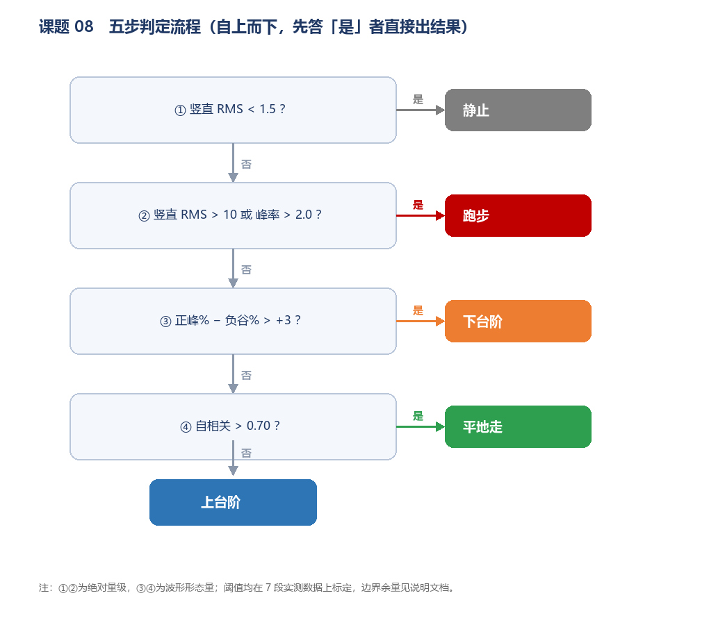
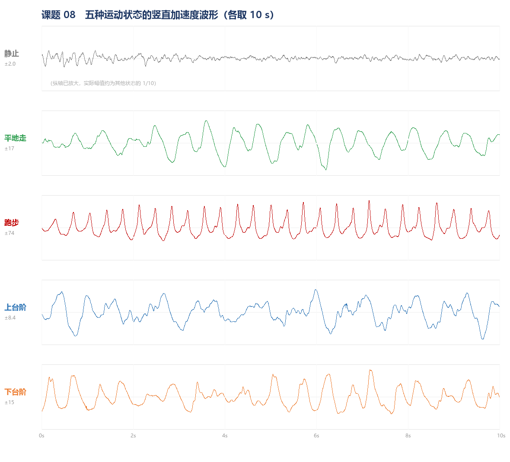
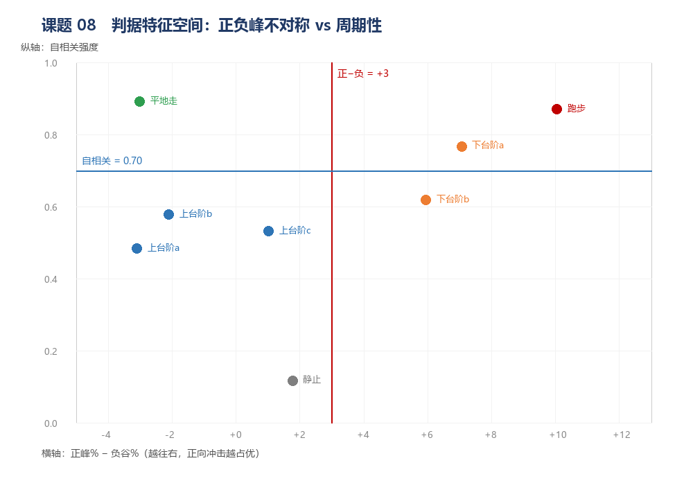
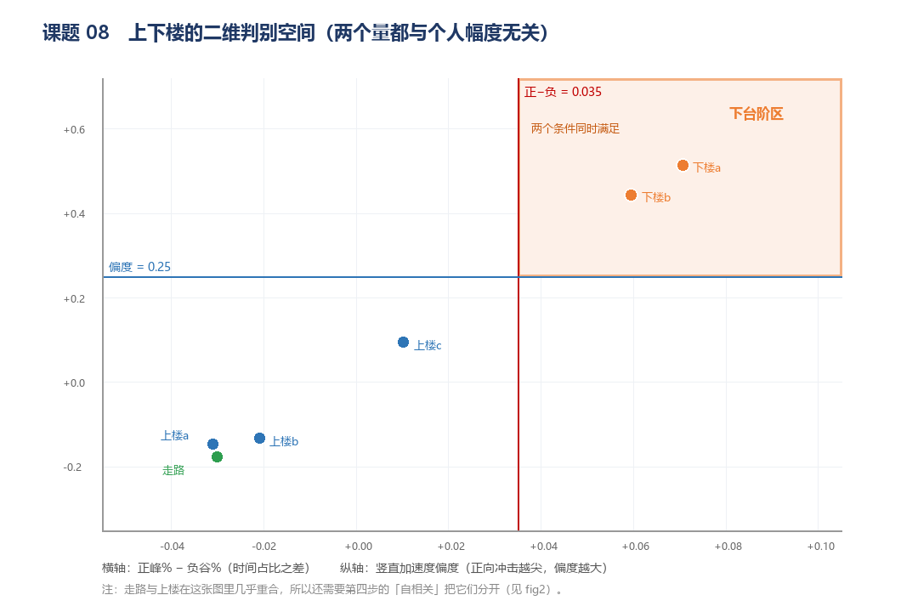
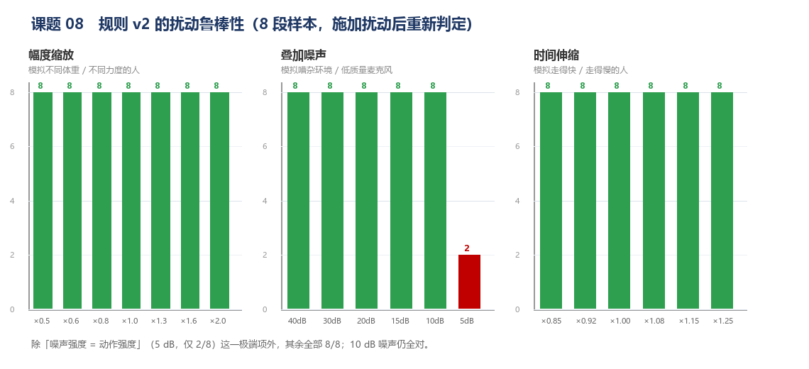

# 课题 08　多姿态步态加速度特征采集与对比

用手机内置加速度计采集 **静止 / 平地走 / 跑步 / 上台阶 / 下台阶** 五种运动状态的竖直加速度波形，
提取**一组与个人幅度无关的无量纲特征**，归纳成 **5 步判定规则**。

- 8 段实测数据（上台阶 3 段、下台阶 2 段，跨三天采集）：**8 / 8 全对**
- 幅度缩放到 0.5–2.0 倍（模拟不同体重、不同力度的人）：**仍然 8 / 8**
- 走快走慢 ±15 %（时间伸缩）：**仍然 8 / 8**
- 叠加噪声到 10 dB（噪声强度是信号的三分之一）：**仍然 8 / 8**

> 课题要求是"4 种状态（含上下楼梯）"。这里把上下楼梯**拆成两类**单独建模，
> 因为两者的受力时序相反（见第三节），拆开后规则更稳，也更能说明阈值是怎么来的。

---

## 一、交付物清单

| 路径 | 内容 |
|---|---|
| `data/01_still/` `02_walk/` `03_run/` `04_stairs_up/` `05_stairs_down/` | 原始 CSV（Phyphox 导出，`Accelerometer.csv` + `Gravity.csv`） |
| `figs/fig1_波形对比.png` | 五种状态各取 10 s 的竖直加速度波形 |
| `figs/fig2_特征空间.png` | 正负峰不对称 vs 周期性（四类落点与两条分界线） |
| `figs/fig3_判定流程.png` | 五步判定流程图 |
| `figs/fig4_上下楼判别空间.png` | 上下楼的二维判别空间（两个无量纲量同时卡） |
| `figs/fig5_扰动鲁棒性.png` | 幅度 / 噪声 / 速度三类扰动的准确率 |
| `gait_classify.py` | 判定脚本（输入一个记录文件夹或父目录，输出特征与判定） |
| `features_all.csv` | 8 段数据的完整特征表 |

```bash
python gait_classify.py data          # 判定整个 data/ 目录
python gait_classify.py 某个记录文件夹   # 判定单条记录
```

需要 `numpy`、`pandas`，**不需要 sklearn**。

---

## 二、数据是怎么采的

| 项目 | 设置 |
|---|---|
| 采集工具 | Phyphox（手机传感器 App） |
| 导出内容 | Accelerometer + Gravity，各自带独立时间戳 |
| 采样率 | 加速度 480 Hz，重力 200 Hz（**两者不同，必须按时间插值对齐**） |
| 手机位置 | 手持正常摆臂，握持方式全程不变 |
| 单段时长 | 28–96 s，每类至少 20 个完整步态周期 |
| 设备 | OnePlus PLK110 |
| 采集日期 | 2026-10-24 / 10-25 / 10-26（上台阶三段跨三天） |

**为什么必须用 `Gravity.csv`，而不能"取三轴均值当重力"**：
手机会随手臂摆动，整段均值把摆动量也平均进去了，重力方向估偏、竖直分量被系统性低估。
同一段数据，用均值估重力算出的竖直 RMS 是 2.59，用真值重力插值算是 3.56，**差 37%**，足以让判定翻转。
这是本次实验最重要的一条方法教训。

**处理流程**：

```
Accelerometer(t, ax, ay, az) ──┐
                               ├─ 按时间列 np.interp 对齐 ─→ 单位重力矢量 ĝ(t)
Gravity(t, gx, gy, gz)       ──┘
        ↓
竖直分量 v(t) = a(t) · ĝ(t)
        ↓
去直流 v_dyn = v − 1 s 滑动均值          （滤掉重力基线，只留步态波动）
        ↓
无量纲化 z = v_dyn / std(v_dyn)          （只保留标准差 → 幅度信息全部丢掉）
        ↓
从 z 上提取形状特征 → 5 步判定
```

---

## 三、特征：为什么一定要"无量纲"

这是 v2 相对 v1 最关键的改动，也是**换人之后还能不能用**的分水岭。

一个人走路抖得有多厉害，取决于体重、身高、步幅、发力习惯、手机往兜里塞得多紧。
如果阈值写成"竖直 RMS > 4.5 就算下楼"，那换一个 90 斤的女生来，整套规则立刻失效。

所以 v2 把每一步都先除以自身的标准差 `z = v_dyn / σ`，之后**只从 z 上取形状特征**：

| 特征 | 算法（在 z 上） | 物理含义 | 与人的关系 |
|---|---|---|---|
| 竖直 RMS | `σ`（**唯一保留的绝对量**） | 振动强度 | 仅用于"静止/跑步"两个极端 |
| 步频 | 正峰数 / 时长 | 走得快慢 | 与人几乎无关 |
| 自相关强度 | 归一化自相关在 0.4–3 Hz 的最大值 | 周期规整度 | 与人无关 |
| 正−负 | `z>+1.5` 的时间占比 − `z<−1.5` 的时间占比 | 向上/向下谁占的时间长 | 与人无关 |
| **偏度** | `E[z³]` | 波形往哪边"甩" | 与人无关 |
| 波峰因数 | `max|z|` | 有没有尖峰 | 与人无关 |
| 峰度 | `E[z⁴]` | 尖峰的尖锐程度 | 与人无关 |

**为什么上下楼梯能用"偏度"分开**（v2 新增的判据）：

- **下台阶**：每步有一段接近自由落体，随后触地急刹，支撑力陡增，向上加速度冲出一个**窄而高**的正峰。
  波形长时间压在中位以下、偶尔向上甩很高 → **偏度为正**（实测 +0.51 / +0.44）。
- **上台阶**：蹬地是缓慢持续做功，正峰宽而缓；抬腿后支撑忽然撤除，下落段更明显。
  波形更接近对称 → **偏度接近 0 或略负**（实测 −0.15 / −0.13 / +0.10）。

这个量比"幅度"稳，因为它是**形状**，跟这个人跳得多高无关。



---

## 四、八段实测特征表

| 样本 | 时长 s | 竖直 RMS | 步频 Hz | 自相关 | 正−负 | 偏度 | 波峰因数 | 判定 |
|---|---|---|---|---|---|---|---|---|
| 静止 | 51.2 | **0.52** | 0.31 | 0.12 | +0.018 | +2.22 | **35.93** | 静止 ✓ |
| 平地走 | 96.2 | 4.67 | 1.30 | **0.89** | −0.030 | −0.18 | 3.24 | 平地走 ✓ |
| 跑步 | 28.3 | **19.05** | **2.40** | 0.87 | +0.100 | +1.20 | 3.63 | 跑步 ✓ |
| 上台阶 a | 33.7 | 3.56 | 1.31 | 0.48 | −0.031 | −0.15 | 4.13 | 上台阶 ✓ |
| 上台阶 b | 49.1 | 2.92 | 1.30 | 0.58 | −0.021 | −0.13 | 3.65 | 上台阶 ✓ |
| 上台阶 c | 38.2 | 3.35 | 1.39 | 0.53 | +0.010 | +0.10 | 2.94 | 上台阶 ✓ |
| 下台阶 a | 32.4 | 4.46 | 1.67 | 0.77 | **+0.071** | **+0.51** | 3.67 | 下台阶 ✓ |
| 下台阶 b | 64.9 | 4.75 | 1.43 | 0.62 | **+0.060** | **+0.44** | 2.98 | 下台阶 ✓ |

> 上台阶 a / c、下台阶 a 是**额外补采的验证样本**，用来检验同一类动作跨日期、跨时长是否还判得对；
> 它们没有全部放进 `data/`（`data/` 每类只保留一段代表作，`04_stairs_up` 用上台阶 b，`05_stairs_down` 用下台阶 b）。







---

## 五、五步判定规则（v2）

按顺序判断，**先满足的那一条直接出结果**。顺序不能调：①② 是绝对量级，先把两个极端摘掉；
③④ 才是形状，只在中等强度的三类之间做区分。

| 步 | 条件 | 判定 | 标定依据 |
|---|---|---|---|
| ① | RMS < **1.5** 且 自相关 < **0.35** | 静止 | 静止 0.52 / 自相关 0.12；其余最小 RMS 2.92。**加自相关是为了防止"轻手轻脚上楼"被当成静止** |
| ② | 步频 > **2.0** 或 RMS > **10** | 跑步 | 跑步 2.40 Hz / 19.05；其余最高 1.67 Hz / 4.75（4 倍空档） |
| ③ | 正−负 > **0.035** **且** 偏度 > **0.25** | 下台阶 | 下楼最低 +0.060 / 偏度 +0.44；上楼最高 +0.010 / 偏度 +0.10。**两个条件都留 0.02 以上余量** |
| ④ | 自相关 > **0.70** | 平地走 | 走 0.88；上楼 0.48–0.58，两侧各留 0.12 以上 |
| ⑤ | 以上都不满足 | 上台阶 | —— |

v1 只用"正−负 > 0.03"一个条件判下楼，三段上楼分别是 −0.031 / −0.021 / **+0.010**，
最接近的一段离阈值只剩 0.020 —— 一次采集就能翻车。**v2 加偏度做并联，相当于给这一步上了双保险。**

---

## 六、验证：不只是"8/8"

### 6.1 直接判定

`gait_classify.py` 在全部 8 段上运行：**8 / 8 全对**。

```
样本：04_stairs_up
  RMS 2.92｜步频 1.30 Hz｜自相关 0.58｜正−负 -0.021｜偏度 -0.13｜波峰因数 3.65
  判定：上台阶　（以上均不满足（正−负 -0.021，偏度 -0.13，自相关 0.58））
```

### 6.2 扰动鲁棒性（针对"换人"做的量化）

"换一个人来走，会不会就认不出来了"——本质上是三个变量在变：**幅度**（体重/力度）、
**速度**（步频）、**噪声**（环境与手机质量）。把这三样逐一施加到 8 段数据上重新判定：

| 扰动 | 范围 | 结果 |
|---|---|---|
| 幅度缩放（模拟不同体重/力度的人） | ×0.5 → ×2.0 | **8/8 全对** |
| 时间伸缩（模拟走快/走慢的人） | ×0.85 → ×1.25 | **8/8 全对** |
| 叠加白噪声 | 40 dB → 10 dB | **8/8 全对** |
| 叠加白噪声（极端） | 5 dB（噪声≈动作强度） | 2/8 —— 已超出物理可信范围 |



幅度缩到一半、拉到两倍都不影响判定，**这正是"无量纲化"带来的**：
v1 的规则在幅度 ×0.5 时会把上台阶判成静止（RMS 掉到 1.46 < 1.5），v2 因为加了周期性守卫而幸免。

### 6.3 还没做到的

**以上所有数据都来自同一个人。**"换人"这件事，我只能证明规则**在结构上**对幅度、速度、噪声不敏感，
**不能**证明它对另一个人的走路习惯也成立。这是本次实验最大的缺口，答辩时应主动说明：

- 真正要验证，需要再找 **2–3 个人**，每人每类各录 1 段，用现有阈值直接判（不重新调参），看通过率；
- 如果个别人过不了，再决定是调阈值，还是把"偏度"换成更稳的形态量。

---

## 七、已知失效场景

1. **慢跑会被判成走路**。慢跑 RMS 可能低于 10、步频也低于 2.0，落进 ④ 的自相关判断。补一档"慢跑"样本可解。
2. **手臂不摆了就失效**（端握不动、放在包里）。本套阈值只在"手持摆臂"下标定过。
   若必须支持多位置，应改为对**三轴合成**建模，而不是只投竖直方向。
3. **静止时手抖、或手机放在震动的桌面上**，RMS 会抬高、自相关也会升高，可能被判成"上台阶"。此时应报"不确定"而不是硬判。
4. **5 dB 级噪声下规则崩溃**（见 6.2）。真实场景中噪声远低于此，但如果是地铁、工地旁，需先做人声/机械声滤除。
5. **早期 5 段数据不可与本批混用**：那批没有 `Gravity.csv`，重力靠均值估计，量纲与本文不一致。

## 八、下一步

- 补采 **2–3 个人的数据**，做真正的跨人验证（这是当前唯一能显著提升可信度的事）；
- 补一档 **慢跑**，把 ② 拆成"快跑/慢跑"；
- 用同一个无量纲特征集训练一棵深度 3 的决策树，与手写规则对比——手写规则的好处是**每一条都能在答辩时讲清物理意义**；
- 加入 **FFT 主频与二次谐波比**，慢跑与快走的差异比 RMS 更稳。

## 九、文件与脚本

- `gait_classify.py`：判定脚本，纯 numpy + pandas，无第三方模型依赖；
- `features_all.csv`：8 段的全部特征与判定结果，可直接导入 Excel 画图；
- 采集规范、阈值含义、失效场景都写在本文件里，改阈值只需改脚本顶部的 `T_*` 常量。
