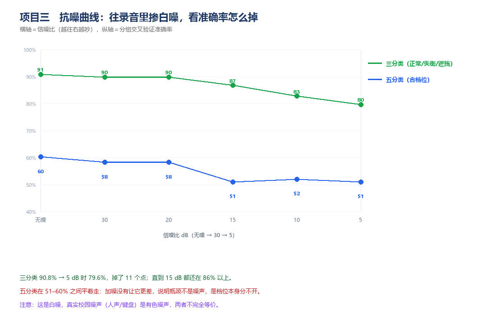

# 抗噪报告

## 1 要回答的问题

「实验室里录得干净，教室里/食堂边也能用吗？」

## 2 做法

对每一段已录好的音频，叠加不同强度的**高斯白噪**，使信噪比降到指定值，再重新提特征，用**分组交叉验证**（每次留出一整个批次）判定。

```python
noise = randn(N)
noise = noise / rms(noise) * rms(signal) / 10**(SNR/20)
x = x + noise
```

六个梯度：无噪、30、20、15、10、5 dB。每档 98 段全部重算，共 570 次特征提取。

## 3 结果



| 信噪比 | 三分类（正常/失衡/遮挡） | 五分类（含档位） |
|---|---|---|
| 无噪 | **90.8 %** | 60.2 % |
| 30 dB | 89.8 % | 58.2 % |
| 20 dB | 89.8 % | 58.2 % |
| 15 dB | 86.7 % | 51.0 % |
| 10 dB | 82.7 % | 52.0 % |
| 5 dB | **79.6 %** | 51.0 % |

口径：分组交叉验证（每次留出一整个批次），特征为最终 6 个（f0 / e_mid / e_high / h2 / h3 / h4）。

## 4 三条读法

### 4.1 三分类的抗噪能力是真的好

从 90.8 % 掉到 79.6 %，**掉 11.2 个百分点**；但直到 15 dB 都还在 86.7 % 以上，10 dB（噪声比信号小 10 倍）时仍有 82.7 %。5 dB 信噪比意味着噪声和信号一样响——这个条件下还有 80 %，说明选的特征（谐波比 + 频段占比）对加性噪声相当不敏感。

原因：白噪在频域上是平的，它抬高的是**所有频段的地板**，而特征用的是**相对占比**与**谐波比值**，地板一起抬高时比值变化有限。

### 4.2 五分类的曲线是平的，这反而说明问题

五类在 51–60 % 之间平着走，**加噪并没让它更差**（无噪 60.2 %，5 dB 51.0 %）。如果瓶颈是噪声，曲线应该明显下降；它是平的，说明瓶颈就是「档位本身分不开」——加不加噪声都分不开。

这条正好和第 4 节的方法说明互相印证。

### 4.3 这个测试有它测不到的东西

| 测到了 | 没测到 |
|---|---|
| 加性白噪（平稳、全频带） | **卷积性噪声**（房间混响） |
| 对信噪比的鲁棒性 | **有色噪声**（人声、键盘、脚步声） |
| 单帧特征稳定性 | 长时间漂移（电机发热后转速变化） |

真实校园里最麻烦的是**人声和键盘声**——它们是宽频瞬态，与「轴承爆点」在频谱上同类，会直接污染 C4/C5 的判据。白噪测试覆盖不到这一块。

## 5 已知的真实噪声污染

采集过程中，第二批录音旁边有人在敲键盘。这批数据**没有剔除**，而是保留在训练集里——等于让模型见过「带键盘声的正常风扇」。

对照实验（把带键盘声的段单独拎出来测）当前样本量不足，未单独统计，记入局限。

## 6 如果要做更严的抗噪

1. 录一段真实的教室/食堂背景（30 s），作为**有色噪声底**叠加，而不是白噪；
2. 用卷积混响（`scipy.signal.fftconvolve` + 实测房间冲激响应）测试混响鲁棒性；
3. 把「噪声段」本身也作为一个类别，让系统能说「现在太吵，测不准」——而不是硬给一个答案。

第 3 条是这套系统下一步最该做的事。
